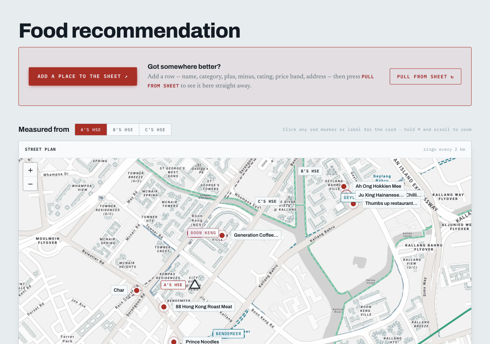
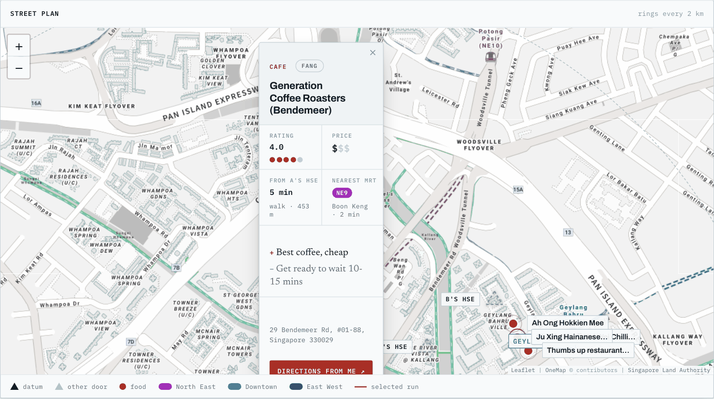
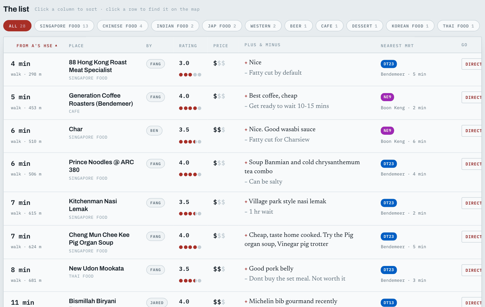

<div align="center">

# 🍜 Food recommendation

### Places worth going back to.

Around Boon Keng, Bendemeer and Geylang Bahru, mostly: what to order, what it cost,<br>
how it scored, how long it takes to get there, and which MRT station actually serves it.

<br>

[](https://fang89.github.io/food-recommendation/)

**👉 [fang89.github.io/food-recommendation/](https://fang89.github.io/food-recommendation/)**

<br>


<br>

<a href="https://fang89.github.io/food-recommendation/"><picture><source media="(prefers-color-scheme: dark)" srcset="docs/screenshots/hero-dark.png"></picture></a>

</div>

---

## The idea

A friend asks where to eat near home. The answer lives in a group Google Sheet that
anyone can add to. This page turns that sheet into something you can actually use on
the way out the door:

| | | |
|:-:|---|---|
| 🏠 | **Three front doors** | Pick whose home you are leaving from. Rings, times and bearings all recompute from that door. |
| ⏱️ | **Minutes, not metres** | OneMap routes every home-to-place trip on foot *and* by public transport, and shows the quicker one. |
| 🚇 | **The station that really serves it** | Nearest MRT from the whole network, in its real line colour, with the walk from the exit. |
| ⭐ | **Rated and priced** | Rating, price band, the plus and the minus, and who recommended it. |
| 🏷️ | **Filter by craving** | Category chips come straight from the sheet. Add a new category there and a chip appears here. |
| 🔄 | **Pull from sheet** | Added a row a minute ago? Press the button and it is geocoded and pinned in your browser on the spot. |

## 🗺️ Click a pin, get the card

Rating, price, travel time from the active door, nearest MRT, the good and the bad,
and a Google Maps walking-directions link that routes from wherever you are standing.

<p align="center"><a href="https://fang89.github.io/food-recommendation/"><picture><source media="(prefers-color-scheme: dark)" srcset="docs/screenshots/card-dark.png"></picture></a></p>

## 📋 The list

Sort by travel time, rating, price or walk to the MRT. Click a row and the map flies there.

<p align="center"><a href="https://fang89.github.io/food-recommendation/"><picture><source media="(prefers-color-scheme: dark)" srcset="docs/screenshots/list-dark.png"></picture></a></p>

> [!NOTE]
> **Privacy by design.** The homes are geocoded from postal codes at build time, but only
> their coordinates ship, under neutral labels (`A's Hse`, `B's Hse`, `C's Hse`). No postal
> code or real name reaches this repo, the page, or a public Actions log.

---

## 🛠️ For contributors

### Updating the list

Anyone can add a row to the sheet. There are three ways to get those edits onto
the page, in increasing order of permanence.

#### 1. From the page itself — **Pull from sheet**

The published page has a **Pull from sheet** button next to the sheet link. It
re-reads the sheet in the browser and redraws the list and the map on the spot:
no terminal, no rebuild, no wait. This works because Google serves the sheet's
CSV export with a CORS header for this site's origin, and OneMap's geocoder
allows any origin — so a row added a minute ago can be located and pinned
client-side.

It tells you what it found (`3 new, 1 updated, 2 removed`) and what it could not
do, and it is explicit that the change is **for that browser tab only**. Nothing
is written back. Reload and you are on the last real build again.

Two things it deliberately cannot do:

- **It never reads the postal-code tab.** Only the food tab's `gid` is compiled
  into the page. The homes are geocoded at build time and only their coordinates
  ship, so a browser pull has no way to reach the postal codes.
- **It never writes anything back.** A pull changes the page in front of you and
  nothing else. Reload and you are on the last published build again; only the
  action below or `./update.sh` makes a change stick.

#### 2. From GitHub — the **Refresh from sheet** action

Actions → *Refresh from sheet* → **Run workflow**. That does the full job on a
runner — re-geocode, recompute the bounding box, smoke test, commit — and Pages
redeploys. Still no terminal. It also runs itself
weekly, so the page does not silently rot if nobody presses anything.

#### 3. From a terminal

```
./update.sh
git add -A && git commit -m "Refresh from sheet" && git push
```

Every push also runs `build/test_refresh.py`, a rebuild that must leave
`index.html` unchanged, and `build/smoke.py` — see **Actions → CI**. The refresh
action only ran those when somebody pressed it, so a hand-pushed change went
straight to the live site untested.

`update.sh` runs three steps:

**`build/refresh.py`** downloads the sheet, geocodes anything new, and rewrites
`data/places.json`, `data/homes.json` and `data/mrt.json`. It is written to
survive the sheet being edited by hand, because this one already has been:

- the header row moves up and down as blank rows come and go, so it is found by
  looking for `Name of place` rather than by row number
- columns are matched by header text, so reordering or inserting one is fine
- a rating typed into the **Minus** column instead of **Rating** is detected and
  moved, with a warning naming the row
- every address is geocoded twice, once by postal code and once by street name,
  and a disagreement is reported — the postal-code match wins, since that is what
  the sheet records
- the map's bounding box is recomputed from the new points, so a place outside the
  current coverage widens it automatically
- only MRT stations that come out nearest to something are kept, so listing extra
  candidates in `config.json` costs nothing

Geocodes are cached in `build/geocache.json` (committed), so a refresh only calls
OneMap for genuinely new addresses. `--force` re-resolves everything. Both caches
are pruned to what the sheet still lists: a deleted place stops shipping its
travel times to every viewer, and stops leaving its address in a public file.

**Home lookups are never cached.** The cache file is committed to a public repo,
and it is keyed by the query, so caching a home would publish its postal code —
the one thing this project takes care to keep out. `geocode(..., private=True)`
skips the cache for those, and every write strips any bare postal-code key an
older build may have left behind.

**`build/build.py`** inlines Leaflet and `data/*.json` into a single `index.html`.
The basemap is not inlined — it comes live from OneMap at view time.

**`build/test_refresh.py`** covers the sheet reader itself — header drift,
reordered columns, the self-closing cell that once made a blank Minus swallow the
Rating beside it, the postal column, and ids that must not collide. It is the
half `smoke.py` cannot reach: every bug this file has had was invisible from the
page, because the map still drew and the table still filled.

**`build/smoke.py`** then runs the built page's script against a stubbed Leaflet
and DOM, and fails if the map never got a view, the table body never got written,
or the **Pull from sheet** button cannot complete a round trip against a canned
sheet and geocoder. A syntax check passes happily on code that throws the moment it runs;
this catches the blank-map case, which is otherwise indistinguishable from
"no data yet". It proves the plumbing executes — it says nothing about how the
page looks, so still open it.

Read the warnings `refresh.py` prints. They are how the sheet tells you it has
drifted.

#### When a home will not geocode

A home is located from the postal code on the sheet's other tab, and only its
coordinates are written into `data/homes.json` — the postal code itself never
reaches this repo or the page. Neither does the name: the sheet labels those
rows with the names of the people who live behind them, so the page names them
from `home_labels` in `data/config.json` instead — `A's Hse`, `B's Hse`, `C's
Hse`, in tab order. That label is the only name there is downstream, warnings
included, so nothing the sheet calls a home reaches a public Actions log either.
Reordering the rows on the sheet swaps which door is which; the labels mean
nothing to a stranger, and the person who can tell they have swapped is the one
who can also see it on the map.

That tab is found by a heading saying **postal code**, not by being the tab that
is not the food list, so tab order is no longer load-bearing. Within it, the codes
are read from whichever column holds six-digit numbers — not from any cell that
happens to look like one, because a price or a year elsewhere on the tab was
otherwise enough to be geocoded and drawn as somebody's front door.

If OneMap cannot resolve one, `refresh.py` says so by label and leaves that home
off the map rather than guessing. To place it anyway, add coordinates under
`home_overrides` in `data/config.json`, keyed by that same `home_labels` name. That
file is public, so an override holds coordinates, not a postal code or a block
number — nothing more identifying than the page already ships. Delete the entry
once the sheet's own code resolves.

### Configuration

`data/config.json` holds everything you would otherwise have to edit code for:
the sheet id and URL, walking speed, the names the homes are shown under
(`home_labels`), hand-written
short labels for places whose names are too long for the map, the stations the
map draws (`mrt`), lines not yet in passenger service (`mrt_lines_excluded`),
and any home whose postal code the sheet has wrong (`home_overrides`).

`data/stations.json` is fetched from OneMap on the first build and cached.
Delete it to refetch — after a new line opens, say.

### How it's built

One `index.html` with Leaflet and the data inlined. The basemap and the fonts
are the only things fetched at runtime.

- **Leaflet** is vendored into `vendor/`.
- **The basemap is live**, from OneMap (Grey by day, Night in dark mode), which
  needs no key. CARTO served it until October 2026, when it began stamping
  "API key required" across every tile. Before that it was baked
  into the page as ~200 WebP data URIs, because the first home for this page was
  a Claude Artifact, where a strict CSP blocks any request to another host. That
  cost 2.8 MB and, worse, fenced the map into the one box those tiles covered:
  fixed zoom range, no panning past the edge. On GitHub Pages nothing blocks a
  tile server, so the tiles come down as needed, the map pans and zooms freely,
  and the page went from 3.03 MB to 0.22 MB.
- **Two station lists, on purpose.** `data/mrt.json` is the handful of stations
  drawn on the map — the neighbourhood. `data/stations.json` is the whole MRT
  network from OneMap, and it is what answers "nearest MRT" in the table. They
  used to be one list, which was fine until the sheet grew a restaurant in
  Chinatown and the page confidently called it a 41-minute walk from Farrer Park.
- **The map opens on as much as can be read.** It takes the doors, then the
  places nearest them, and stops at the last one that still leaves the view above
  the zoom where labels are hidden — so it never opens as a field of anonymous
  dots. On a screen too narrow to hold even the three doors that way, it opens on
  the door you are measuring from. A place beyond that still gets its pin and its
  row; clicking the row flies there.

  This replaced "the places served by the stations the map draws", which was the
  neighbourhood right until the sheet grew a place beside a seventh station: that
  one row pulled the opening view a zoom level out, past the label threshold, and
  the page opened with twenty-five nameless markers.
- **Category and Recommended by come from the sheet.** Category drives the filter
  chips above the list; adding a new one to the sheet adds a chip, with nothing
  to edit here. Recommended by is its own sortable column.
- **Both themes ship.** The tile layer swaps with the viewer's light/dark setting.
- **It is a real HTML document** — doctype, `<head>`, and a `width=device-width`
  viewport. It shipped for a while as a bare fragment, because the Artifact host
  used to supply the document around it; GitHub Pages supplies nothing, so mobile
  Safari laid the page out at 980px and scaled it down, and a pinch zoomed the
  page rather than the map.
- **Place data is never hand-edited.** It comes from `data/*.json`, which comes from
  the sheet.

### Travel times

The lead column, **From <home>**, is how long it takes, not how far it is. OneMap costs
every home-to-place pair two ways at build time — on foot, and by public
transport — and the page shows whichever is quicker, saying which it is. A
number of minutes means nothing if the reader cannot tell whether they are
walking it or catching a train.

Routing is the one OneMap service that needs a login. Get a free account at
[onemap.gov.sg](https://www.onemap.gov.sg/) (no card, no billing). For a one-off
local build a token copied from the OneMap dashboard is enough — it lasts about
three days:

```
export ONEMAP_TOKEN=eyJhbGci...
```

For the weekly action, use the email and password instead, so the build mints
its own token and nothing expires under it. Add them as repository secrets under
**Settings → Secrets and variables → Actions**, or locally in
`build/onemap.auth.json`, which is gitignored because this repo is public and a
credential in it would be a credential published:

```json
{ "email": "you@example.com", "password": "..." }
```

Without a login the build still succeeds: every row falls back to a
straight-line walking estimate and labels itself *est. on foot*, so a missing
credential looks like a missing credential rather than like data.

Answers are cached in `data/routes.json`, keyed by coordinates, so a rebuild
only asks about pairs it has never seen. Move a place and it is asked again;
rename one and nothing happens. Two places in the same building share one entry,
because they are the same journey. The itinerary is planned for a representative
weekday midday (`route_when` in `config.json`) rather than for the moment of
the build, so the same page does not report different numbers each time it is
rebuilt.

### Moving around the map

The map is a tall panel in the middle of a page that scrolls, so it must not
swallow a scroll meant for the page. It takes the two gestures that say
unambiguously "I mean the map", which are the ones Google Maps already uses:

| | zoom | pan |
|---|---|---|
| mouse | hold **⌘**/**Ctrl** and scroll, or the **+ −** buttons, or double-click | drag |
| trackpad | pinch | two-finger drag with ⌘, or drag |
| phone | pinch with two fingers | drag with two fingers |

A plain wheel, or one finger on a phone, scrolls the page — and the map says so
in a pill for a second, rather than just ignoring you. Once you have clicked the
map, a plain wheel zooms it too: by then the map is plainly what you are using.

On a touch screen Leaflet's dragging handler is switched off at load. That is
what leaves `touch-action` at `pan-x pan-y`, which is what lets the browser keep
the one-finger scroll for itself. It has to be decided before the first gesture,
because `touch-action` is read when a gesture begins.

### Caveats

- **Distances are geodesic** — straight lines from the datum, not walking routes.
  Allow roughly 15–30% more on foot once crossings and the canal are counted.
- **Distance rings are not isochrones.** They show separation, not reachability.
- **Station pills can sit over a place marker** where the two coincide. Click the
  marker underneath, or zoom in and they separate.
- **An interchange is named by one of its codes**, whichever OneMap indexed
  nearer. Chinatown may read NE4 or DT19; both are the same station.
- Entries with no plus/minus written up yet say so.
- **A browser pull is not a build.** It changes what you are looking at, not what
  is published. Use the GitHub action or `./update.sh` to make it stick.

### Attribution

Basemap, geocoding and routing © [OneMap](https://www.onemap.gov.sg/),
Singapore Land Authority.
